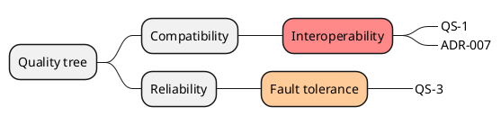

# PlantUML quality tree

Use the project's existing conventions. For a new diagram using priority colors, the imported workflow assigns `#FF8888` to a quality goal, then `#FFAAAA`, `#FFCC99`, `#FFFFAA`, and `#CCFFCC` to A through D. Legend text should explain the colors and ID types.

Use the underscore directly after the asterisks for an unboxed scenario or ADR leaf. Keep such leaves uncolored.
